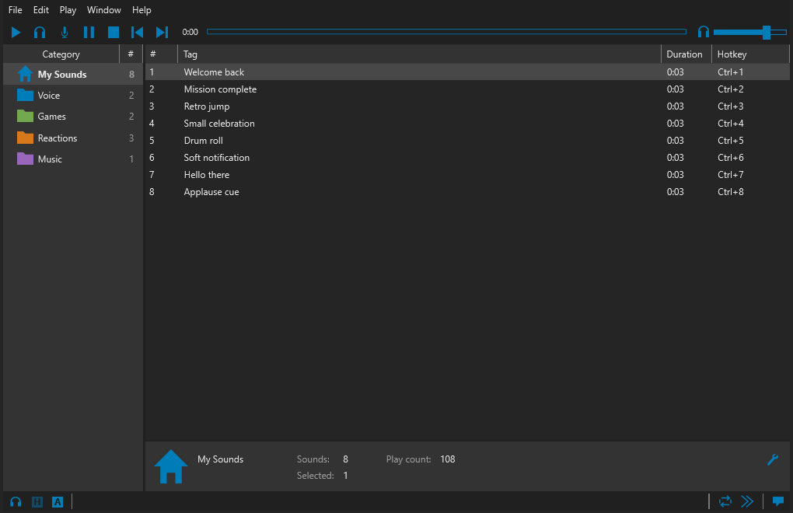
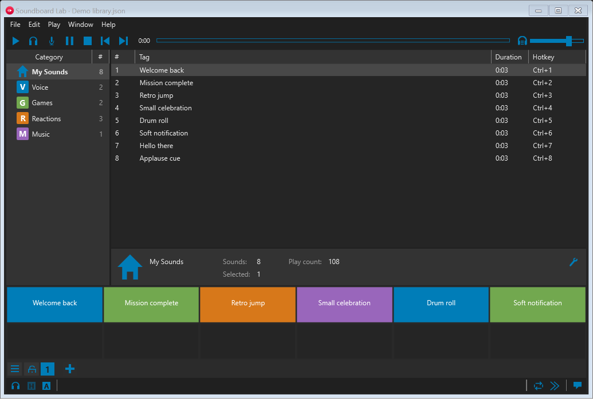
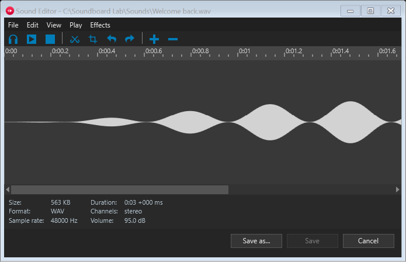
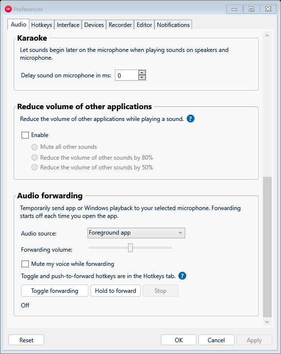
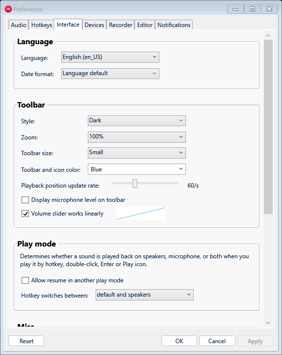
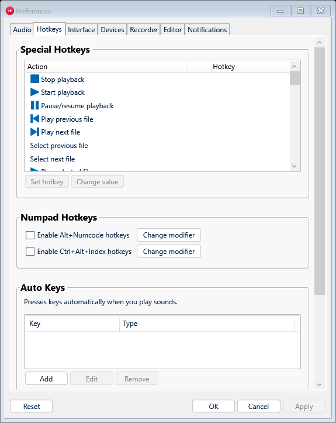
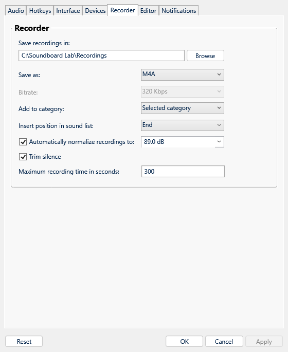

# Soundboard Lab

[](https://github.com/Loukious/soundboard-lab/actions/workflows/build-release.yml)
[](#download)
[](#build-from-source)

A Windows soundboard with global hotkeys, categories, a waveform editor, and audio mixing into your existing microphone. Built with C# / WPF and a native C++ Audio Processing Object (APO).

**Development preview.** Microphone support depends on the device, driver, and voice application. The native audio component is unsigned.



## Features

- Play audio to speakers, your existing microphone, or both. No additional virtual microphone is created.
- Organize sounds into nested categories; search, sort, rename, tag, and export your library.
- Use global keyboard/mouse hotkeys, category shortcuts, special actions, and a configurable hotbar.
- Forward audio from a foreground app or the whole PC, with **toggle** and **push-to-forward** controls.
- Set independent speaker volume, microphone gain, loudness normalization, and voice blocking.
- Record speakers or microphone; trim/crop selections, fade, reverse, and export WAV, MP3, or M4A.
- Generate speech with installed Windows voices and add it to the library.
- Keep backups, undo/redo edits, and control playback with the included named-pipe CLI.

### Hotbar and editor





## Download

Download **SoundboardLab-0.1.2-windows-x64.zip** from the [latest numbered release](https://github.com/Loukious/soundboard-lab/releases/latest), extract the entire archive, and run **SoundboardLab.exe**. The .NET runtime is included; keep its accompanying DLLs and installer scripts together. Builds from `main` are also available in the [development preview](https://github.com/Loukious/soundboard-lab/releases/tag/preview).

The release includes `SHA256SUMS.txt`. Check your download with:

```powershell
Get-FileHash .\SoundboardLab-0.1.2-windows-x64.zip -Algorithm SHA256
```

Requires Windows x64 with working Windows audio services/codecs. Audio forwarding requires **Windows build 20348 or later**, including Windows 11. Speech generation needs an installed SAPI voice. Public builds use English UI strings and synthesize notification cues and activation noise on first launch.

## Getting started

1. Add audio files or drag a folder into the window.
2. Double-click a sound to play it; use the headphone button for speaker preview.
3. Choose the playback destination with the bottom-left play-mode icon.
4. Assign a shortcut by clicking a sound's Hotkey cell. Enable global hotkeys using the H status icon.
5. Open **File → Preferences** to configure audio, shortcuts, appearance, devices, recording, and editing.

The speaker slider changes this app's playback gain without changing Windows master volume or other apps. The separate **Reduce volume of other applications** option deliberately enables Windows communications ducking when selected.

### Microphone mixing

Open **Preferences → Devices**, check the microphone used by your voice app, and click **Repair**. Windows requests administrator access to install the component. The compiled setup helper uses Windows APIs directly and backs up the previous endpoint effects for restoration; the app does not launch PowerShell for device configuration.

Reopen apps using that microphone after setup. If Windows keeps the old audio graph, choose **Restart Win-Audio** from the device's context menu when convenient; this interrupts Windows playback and recording.

Restore the original configuration from an elevated PowerShell window:

```powershell
.\installer\Restore-Microphone.ps1 -EndpointId '<full recording endpoint ID>'
```

Device IDs are available through the microphone-setup tool and diagnostic export. Setup does not enable test signing or change Secure Boot settings. Device/driver compatibility remains under development.

### Temporary audio forwarding

Open **Preferences → Audio → Audio forwarding**.

| Source | Behavior |
|---|---|
| Foreground app | Captures the selected app and its child processes when forwarding starts. Switching windows keeps that source. Starting from Preferences uses the most recently active external app. |
| Whole PC | Captures Windows playback across output devices, excluding Soundboard Lab's own process tree. |

Choose the source, forwarding volume, and whether to mute your voice. Use **Toggle forwarding** to latch it on/off, **Hold to forward** while pressed, or **Stop** to end forwarding.

In **Preferences → Hotkeys → Special Hotkeys**, assign **Toggle audio forwarding** and **Push to forward audio**. Push forwarding stops when its key/mouse button or a required modifier is released, or when hotkeys are disabled/reassigned. Toggle and held controls can coexist; releasing a held control preserves a latched toggle. Wheel impulses cannot be held shortcuts.

Forwarding starts **off** at every launch, saves no recording, and does not change system volume. Starting/stopping forwarding stops the current sound while the transport changes; clips played during forwarding are mixed with it. Whole-PC mode also includes voice-chat playback, so avoid microphone monitoring in your voice app while forwarding.



<details>
<summary>More Preferences screenshots</summary>







</details>

Screenshots show the actual WPF controls with an isolated demo library of generated audio. Recreate them with `dotnet run --project tools/screenshots -- docs/screenshots`; the renderer does not show windows or send desktop input.

## Build from source

Install [.NET 10 SDK](https://dotnet.microsoft.com/download/dotnet/10.0) and Visual Studio 2022 or newer / Build Tools with **Desktop development with C++** and a Windows 10/11 SDK containing the APO headers/libraries.

```powershell
git clone https://github.com/Loukious/soundboard-lab.git
cd soundboard-lab
.\build.ps1 -CI
```

MSVC and the Windows SDK are discovered automatically. `-CI` runs native callback tests, offline audio-processing tests, service tests, and hidden WPF layout checks without requiring audio devices or speech voices. Output is always **artifacts\SoundboardLab-preview**. Local builds do not create ZIPs or timestamped package folders. Close a preview running from that folder before rebuilding it.

`./build.ps1` runs the broader local suite, including muted speaker/loopback and installed-voice checks. It does not capture a physical microphone by default. `-SkipNativeBuild` reuses an existing native build. Custom toolchain paths can be passed to `native/build-native.ps1` with `-CompilerRoot`, `-SdkRoot`, and `-SdkVersion`.

Original binaries, external translation/notification resources, user libraries, device backups, recordings, and local analysis captures are excluded from Git and CI releases. Optional externally supplied catalogs can be prepared with `Prepare-Translations.ps1 -SourceDirectory <folder>`.

### Automated releases

[Build and release](.github/workflows/build-release.yml) runs on `main` pushes, pull requests, `v*` tags, and manual dispatch:

- Successful `main` builds update the **preview** prerelease and its downloadable ZIP/checksum.
- Numbered releases use `vMAJOR.MINOR.PATCH` tags, starting with **v0.1.0**. Before 1.0, minor versions introduce features and patch versions contain fixes. A suffix such as `-rc.1` creates a prerelease.
- The version in `app/SoundboardLab.csproj` is the source for the app, diagnostics, build metadata, and `SoundboardLab-<version>-windows-x64.zip` filename. Tagged builds fail if the tag does not match it. Each release needs a matching entry in [CHANGELOG.md](CHANGELOG.md), which supplies its release notes.
- Pull requests build and test without publishing.

The workflow uses GitHub's built-in token; no personal token or repository secret is required. ZIP packaging is a separate CI step, keeping local `build.ps1` behavior unchanged.

## Remote control

With the app running:

```powershell
.\Remote.ps1 -Command state
.\Remote.ps1 -Command play -Index 0 -Mode Speakers
.\Remote.ps1 -Command pause
.\Remote.ps1 -Command seek -Seconds 1.5
.\Remote.ps1 -Command stop
```

The current-user pipe is `SoundboardLab`. Isolated instances can use `--data-dir <directory> --pipe-name <name>`; pass the matching `-PipeName` to the CLI. Library/preferences normally live under `%LOCALAPPDATA%\SoundboardLab`.

## Validation and limitations

See [VALIDATION.md](VALIDATION.md) for test scope, [PREFERENCES.md](PREFERENCES.md) for settings, and [FEATURES.md](FEATURES.md) for implementation coverage.

CI validates audio processing and native callbacks; it cannot establish physical microphone, driver, or voice-app compatibility. Both process-loopback capture modes have also initialized locally without microphone injection. Live forwarding into a voice app still needs device-specific verification. Protected/exclusive audio and apps with unusual process layouts may not be captured. The setup dialog exposes this mixer's four slots rather than driver-specific numbered modes. Soundpad `.spl` import supports known library/category/hotbar data and reports unknown metadata.

Default builds and screenshots do not move the mouse, activate windows, or start communications ducking. Interactive and communications tests require separate explicit opt-ins.

## Project layout

| Directory | Contents |
|---|---|
| `app/` | WPF interface, audio engine, library, hotkeys, forwarding |
| `native/` | APO, shared-memory transport, MSVC build script |
| `installer/` | Setup, repair, restoration, audio restart |
| `tests/` | Native, managed, hidden UI, opt-in live integration |
| `tools/screenshots/` | Renderer using actual app controls |
| `docs/screenshots/` | README screenshots |
| `ci/` | Release archive packaging |

Dependencies and notices are listed in [THIRD-PARTY-NOTICES.md](THIRD-PARTY-NOTICES.md).
